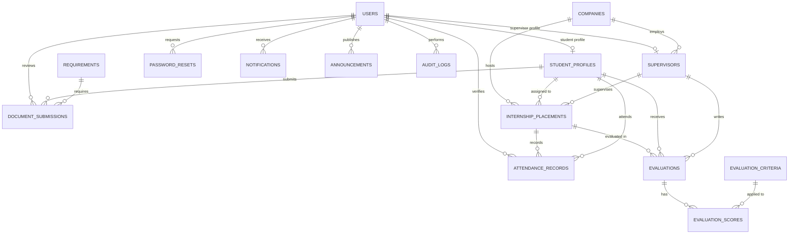

# Internship Tracking System — EERD

Enhanced Entity-Relationship Diagram for the `internship_tracking_system`
database (MySQL / MariaDB).

- **Rendered image:** [`EERD.png`](EERD.png)
- **Viewable / printable page:** [`eerd.html`](eerd.html) (open in a browser → Print → Save as PDF)
- **Mermaid source:** [`eerd.mmd`](eerd.mmd)

Legend: `PK` primary key · `FK` foreign key · `UK` unique ·
`||--o{` one-to-zero-or-many · `||--o|` one-to-zero-or-one.

---

## 1. Entities

| Entity | Purpose | Primary key | Foreign keys |
|---|---|---|---|
| `users` | All login accounts (student, supervisor, coordinator) | `id` | — |
| `password_resets` | Password-reset tokens | `id` | `user_id → users` |
| `student_profiles` | Student intern details | `id` | `user_id → users` |
| `companies` | Partner companies | `id` | — |
| `supervisors` | Company supervisor details | `id` | `user_id → users`, `company_id → companies` |
| `internship_placements` | Student assigned to a company + supervisor | `id` | `student_id → student_profiles`, `company_id → companies`, `supervisor_id → supervisors` |
| `requirements` | Documents a student must submit | `id` | — |
| `document_submissions` | Uploaded files + review status | `id` | `requirement_id → requirements`, `student_id → student_profiles`, `reviewer_id → users` |
| `attendance_records` | Time in/out and rendered hours | `id` | `placement_id → internship_placements`, `student_id → student_profiles`, `verified_by → users`, `corrected_by → users` |
| `evaluation_criteria` | Scoring criteria + weights | `id` | — |
| `evaluations` | Supervisor evaluation of a placement | `id` | `placement_id → internship_placements`, `student_id → student_profiles`, `supervisor_id → supervisors` |
| `evaluation_scores` | Rating per criterion (bridge, M:N) | `evaluation_id, criteria_id` | `evaluation_id → evaluations`, `criteria_id → evaluation_criteria` |
| `notifications` | Per-user in-app notices | `id` | `user_id → users` |
| `announcements` | Coordinator broadcasts | `id` | `created_by → users` |
| `audit_logs` | Security-relevant actions | `id` | `user_id → users` |

---

## 2. Specialization / Generalization (ISA)

`USERS` is a **superclass** specialized into two subtypes:

- `STUDENT_PROFILES` — where `role = 'student'`
- `SUPERVISORS` — where `role = 'supervisor'`

The specialization is:

- **Disjoint** — every user has exactly one `role`.
- **Partial** — a coordinator is a `USERS` row with `role = 'coordinator'`
  and has no separate subtype table.

The **discriminator attribute** is `USERS.role`.

---

## 3. Relationships and cardinality

| Relationship | Cardinality |
|---|---|
| `users` → `student_profiles` | 1 : 0..1 |
| `users` → `supervisors` | 1 : 0..1 |
| `users` → `password_resets` | 1 : 0..N |
| `users` → `notifications` | 1 : 0..N |
| `users` → `announcements` (publishes) | 1 : 0..N |
| `users` → `audit_logs` | 1 : 0..N |
| `users` → `document_submissions` (reviews) | 1 : 0..N |
| `users` → `attendance_records` (verifies / corrects) | 1 : 0..N |
| `companies` → `supervisors` | 1 : 0..N |
| `companies` → `internship_placements` | 1 : 0..N |
| `student_profiles` → `internship_placements` | 1 : 0..N |
| `supervisors` → `internship_placements` | 1 : 0..N |
| `student_profiles` → `document_submissions` | 1 : 0..N |
| `requirements` → `document_submissions` | 1 : 0..N |
| `internship_placements` → `attendance_records` | 1 : 0..N |
| `student_profiles` → `attendance_records` | 1 : 0..N |
| `internship_placements` → `evaluations` | 1 : 0..N |
| `student_profiles` → `evaluations` | 1 : 0..N |
| `supervisors` → `evaluations` | 1 : 0..N |
| `evaluations` → `evaluation_scores` | 1 : 1..N |
| `evaluation_criteria` → `evaluation_scores` | 1 : 0..N |

`evaluations` ↔ `evaluation_criteria` is a **many-to-many** relationship
resolved by the `evaluation_scores` bridge entity (which also carries the
`rating` attribute).

---

## 4. Mermaid source

See `eerd.mmd` for the full definition including every attribute and key.
